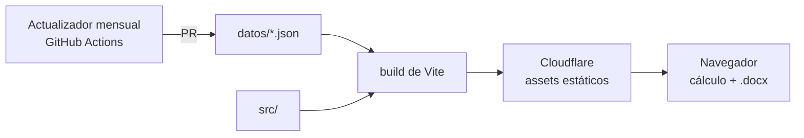

# Calculadora de honorarios

Calculadora web de honorarios por hora para trabajadores autónomos de la
comunicación —community managers, cronistas, creadores de contenido,
conductores, redactores, fotoperiodistas, productores y editores de video—
monotributistas de Chaco y Corrientes.

El honorario parte del salario del convenio colectivo de cada rol y le suma,
según lo que el usuario marque, los adicionales de convenio, los costos que el
autónomo paga de su bolsillo (monotributo, ingresos brutos, equipo,
conectividad, movilidad), los fondos de vacaciones y aguinaldo y un ajuste por
tipo de cliente. El resultado se descarga como presupuesto en Word, editable,
con número, los datos de las dos partes, el trabajo con su valor por hora, el
total y las condiciones de pago; una vista previa al lado muestra la hoja
mientras se completa. El desglose de costos queda en la pantalla.

## Arquitectura

Sitio estático, sin backend ni base de datos. El cálculo y el documento Word se
generan en el navegador: nada de lo que carga el usuario sale de su equipo.
Los datos fijos del profesional (rol, costos marcados, nombre) se recuerdan en
el `localStorage` de su navegador; las horas y el cliente de cada trabajo, no.



Los valores —roles, ítems, categorías de monotributo, ingresos brutos por
provincia, precio del combustible— viven en `datos/`, con su vigencia y la norma
que los respalda, y se validan contra un esquema. El código no contiene montos:
agregar un rol, un ítem o una categoría es agregar un dato.

## Datos

| Archivo | Qué guarda |
|---|---|
| `roles.json` | Los roles, con su valor base mensual y el convenio del que sale |
| `items.json` | Los ítems del honorario, sus grupos (con sus subgrupos plegables) y los conjuntos excluyentes (plazo, tipo de cliente) |
| `monotributo.json` | Categorías del monotributo: impuesto integrado, SIPA, obra social y tope |
| `provincias.json` | Cómo tributa ingresos brutos un monotributista en cada provincia |
| `combustible.json` | Precio del litro de nafta por provincia |
| `parametros.json` | Horas mensuales, jornada, vida útil de equipos, consumo del auto, vacaciones, SAC y dólar |
| `esquema/` | Un JSON Schema por archivo, más `comun.schema.json` con las definiciones compartidas |

Cada valor lleva su `vigencia` (`AAAA-MM`) y la `norma` que lo respalda. Los
ítems tienen un `tipo` que define cómo entran al cálculo:

| Tipo | Cómo se calcula |
|---|---|
| `porcentual` | Porcentaje del valor hora por las horas del trabajo |
| `mensual` | Costo mensual prorrateado por hora; en pesos (`valor`) o en dólares (`dolares`) |
| `por-jornada` | Monto por cada jornada de 6 horas, redondeando hacia arriba |
| `por-trabajo` | Monto que carga el usuario, una vez por trabajo |
| `calculado` | Fórmula propia del motor (`monotributo`, `ingresos-brutos`, `fondo-vacaciones`, `fondo-sac`, `amortizacion`, `movilidad`) |

`porRol` reemplaza el valor para un rol puntual. `actualizacion.regla` indica
cómo se mantiene al día el valor: `manual`, `ipc-nea`, `dolar-oficial`,
`combustible` o `fija`.

Para cambiar o agregar un valor se edita el JSON y se corre
`npm run validar-datos`. La verificación de cada PR lo corre también, y los
tests comprueban las referencias entre archivos y que ningún monto quede
escrito en `src/`.

## Interfaz

Una sola página (`src/paginas/Calculadora.tsx`) que se arma desde `datos/`: los
roles, los grupos, las casillas, las opciones excluyentes y las categorías
salen de los JSON, así que un ítem o una categoría nueva aparece sola. El
estado del formulario vive en `useCalculadora`; `src/util/formulario.ts` lo
traduce a la selección que recibe el motor, y el resultado se recalcula con
cada cambio.

| Componente | Qué hace |
|---|---|
| `layout/Encabezado` · `layout/PieDePagina` | Título, vigencia de los valores, aviso, fuentes y crédito |
| `componentes/CampoNumerico` | Campo de texto con teclado decimal; acepta «1,5» y «2.400.000» |
| `componentes/OpcionesExcluyentes` | Radios de un conjunto excluyente (tipo de cliente, plazo) |
| `componentes/ItemConCasilla` | Casilla de un ítem, con los datos que pide al marcarse |
| `componentes/Aporte` | «Suma $ X a este trabajo» bajo cada ítem marcado, o qué dato le falta |
| `componentes/SubgrupoPlegable` | Subgrupo plegable de costos operativos, con lo que suma sin abrirlo |
| `componentes/SelectorDeVehiculo` | Auto o moto, que fija el consumo por defecto |
| `componentes/TituloDeSeccion` | Título de cada panel con su ícono |
| `componentes/NormaDelItem` | Norma y vigencia de cada ítem, plegable |
| `componentes/Desglose` | Total, renglones y lo que falta para calcular; anuncia el total a los lectores de pantalla |
| `componentes/ComposicionDelTotal` | Barra y leyenda de la composición del total |
| `componentes/SelectorDeMoneda` | Pesos o dólares, debajo del desglose |
| `componentes/BarraDelTotal` | Total fijo abajo en el celular, con enlace al desglose |
| `componentes/DescargaDePresupuesto` | Datos del presupuesto y descarga del `.docx`, que se genera con `import()` al pedirlo |
| `componentes/VistaPreviaDelPresupuesto` | La hoja del presupuesto en HTML; lee el mismo contenido que el `.docx` (`util/presupuesto/contenido.ts`) |

**Tema.** Oscuro siempre, sin depender de la preferencia del sistema
(`color-scheme: dark`). La paleta vive en `src/estilos/tokens.css` con los
contrastes calculados de cada par: base verde azulada casi negra, el petróleo
de marca en la franja del encabezado, un único verde agua para lo elegido y un
ámbar para el foco del teclado y los avisos. El verde agua más luminoso es sólo
del total. Las casillas y los radios se dibujan con esos colores, iguales en
todos los navegadores.

**Tipografía.** Dos familias de diseñadores argentinos: Alegreya (Juan Pablo
del Peral, Huerta Tipográfica) para títulos, el valor hora y el total, y
Archivo (Omnibus-Type) para el resto. Las dos son variables y autoalojadas con
`@fontsource-variable`: van dentro del bundle y se precargan en `index.html`.
Los montos usan cifras tabulares para que no bailen al recalcular.

**Composición.** Cada sección del formulario es un panel con su ícono (Lucide,
dentro del bundle); adentro, cada ítem va en un marco como el de las opciones,
y la marca dice si suma (cuadrado) o si se elige (círculo; también en los
costos operativos, por pedido del cliente). El panel del resultado muestra debajo
del total una barra con su composición (honorario base, adicionales, impuestos
y fondos, costos), que sale de `util/composicion.ts`: lo que queda para el
profesional en verde, lo que se va en grises. En escritorio esa cabeza queda
fija y el desglose sigue el scroll de la página.

**Movimiento.** Uno solo: al cambiar, el total cuenta hasta su valor nuevo
(`hooks/useNumeroAnimado.ts`) y la barra de la composición se reacomoda. Con
`prefers-reduced-motion` el número salta directo y la barra no se anima.

Los headers de seguridad que aplica Cloudflare están en `public/_headers`.

## Estructura

| Ruta | Qué vive adentro |
|---|---|
| `datos/` | Valores de cálculo y su esquema |
| `scripts/` | `validar-datos.mjs` y `actualizar-dolar-blue.ts`, que trae la cotización del día |
| `src/main.tsx` · `src/App.tsx` | Arranque |
| `src/util/datos/` | Carga tipada de `datos/` |
| `src/util/` | Funciones puras: motor de cálculo, armado del presupuesto (`presupuesto/`, con `fechas.ts` aparte para no arrastrar `docx` al bundle principal) y `memoria.ts`, lo que se recuerda entre visitas |
| `src/paginas/` · `src/componentes/` · `src/layout/` | Interfaz |
| `src/hooks/` | `useCalculadora` (estado del formulario), `useNumeroAnimado` (el total que cuenta) y `useValorDiferido` (el anuncio del total cuando se termina de escribir) |
| `src/contexto/` | `Moneda.tsx`: el formato de la moneda elegida, que usan todos los montos de la pantalla |
| `src/estilos/` | `tokens.css` (variables de diseño), `base.css`, `calculadora.css` (página y formulario) y `desglose.css` (resultado) |
| `src/test/` | Tests de Vitest, espejando `src/` |
| `.github/workflows/` | Verificación de cada PR, publicación desde `main` y dólar blue diario |
| `wrangler.jsonc` | Worker de Cloudflare que sirve `dist/` |

## Cómo se corre

Requiere Node 24.

```sh
npm ci
npm run dev      # servidor de desarrollo
npm test         # tests
npm run validar-datos  # datos/ contra sus esquemas
npm run lint     # ESLint
npm run build    # tipos + build de producción en dist/
```

## Ramas

`develop` integra; `main` es lo publicado. Cada cambio entra a `develop` por PR
desde una rama `feature/…`, y la verificación (lint, tipos, tests y build) tiene
que pasar antes de mergear.

## Despliegue

El sitio es un Worker de Cloudflare sólo de archivos estáticos, configurado en
`wrangler.jsonc`: sirve `dist/` y aplica los headers de `public/_headers`. Se
publica solo al llegar un merge a `main`. La acción `Publicación` repite la
verificación, construye y sube con `wrangler deploy`. Necesita dos secretos en el
entorno `produccion` del repo: `CLOUDFLARE_API_TOKEN`, un token con permiso de
edición de Workers, y `CLOUDFLARE_ACCOUNT_ID`.

### Dólar blue diario

Un selector «Pesos / Dólares» muestra todos los montos del resultado y del Word
en dólares. El motor calcula en pesos y recibe un `Formato` (`src/util/moneda.ts`)
que convierte cada renglón y lo redondea a centavos; el total es la suma de los
renglones, como en pesos. La conversión usa el dólar blue (venta) de
`datos/parametros.json`.
El sitio no consulta ninguna API: todos los días, la Action `Dólar blue`
corre `npm run actualizar-dolar-blue`, que lee dolarapi.com. Si la cotización
cambió, un primer job corre la verificación completa sobre ese cambio; un
segundo, que no instala dependencias, abre un PR a `main` que toca sólo ese
valor, lo mergea, sincroniza `develop` y publica. Un valor menos de la
mitad o más del doble que el anterior frena la corrida sin tocar nada. La
Action necesita que el repo permita a GitHub Actions crear PR (*Settings →
Actions → General*).
