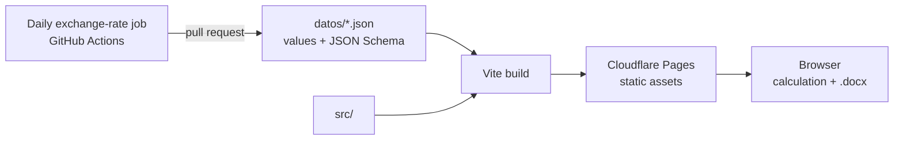

# Fee Calculator for Freelance Communicators

Web app that calculates an **hourly rate** for freelance communication workers — community managers, reporters, content creators, hosts, copywriters, photojournalists, producers and video editors — registered under Argentina's simplified tax regime (*monotributo*) in the provinces of Chaco and Corrientes.

The rate starts from the collective-agreement salary for each role and adds, depending on what the user selects, agreement bonuses, the costs a freelancer pays out of pocket (taxes, equipment, connectivity, transport), vacation and year-end bonus funds, and an adjustment by client type. The result downloads as an **editable Word quote** — numbered, with both parties' details, the work and its hourly value, the total and payment terms — and a live preview shows the document while it's being filled in.

**Live:** [calculadora-honorarios-nea.pages.dev](https://calculadora-honorarios-nea.pages.dev)


## Architecture

A static site with no backend and no database. The calculation and the Word document are generated in the browser, so nothing the user types ever leaves their device. Stable details (role, selected costs, name) are remembered in `localStorage`; each job's hours and client are not.



**Data-driven by design.** Every value — roles, line items, tax categories, provincial gross-income tax, fuel prices — lives in `datos/` with its effective date (`vigencia`) and the regulation that backs it, validated against a JSON Schema. The code contains no amounts: adding a role, an item or a tax category means adding data, and the UI picks it up automatically.

| File | Contents |
|---|---|
| `roles.json` | Roles, their monthly base salary and source agreement |
| `items.json` | Fee items, their groups and collapsible subgroups, and mutually exclusive sets (deadline, client type) |
| `monotributo.json` | Simplified-regime categories: tax, pension, health insurance and caps |
| `provincias.json` | How each province taxes gross income |
| `combustible.json` | Fuel price per province |
| `parametros.json` | Monthly hours, working day, equipment lifespan, vehicle consumption, vacation, year-end bonus and USD rate |

Each item has a `tipo` that defines how it enters the calculation: `porcentual` (percentage of the hourly value), `mensual` (monthly cost spread per hour, in pesos or dollars), `por-jornada` (per 6-hour working day), `por-trabajo` (one-off amount per job) or `calculado` (a dedicated formula in the engine: taxes, vacation fund, depreciation, transport).

## Features

- **Live calculation:** the result recomputes on every change, with a breakdown per line item and a bar showing how the total is composed (base fee, bonuses, taxes and funds, costs).
- **Word quote** generated client-side with `docx`, loaded on demand with `import()` so it stays out of the main bundle; the HTML preview reads the same content model as the `.docx`.
- **Pesos or US dollars:** every line is converted and rounded to cents, and the total is the sum of the lines.
- **Accessible:** the total is announced to screen readers once typing stops, every state is distinguishable without relying on color, and animations respect `prefers-reduced-motion`.
- **Designed, not templated:** dark theme with contrast ratios calculated for every color pair, self-hosted variable fonts by Argentine type designers (Alegreya and Archivo) and tabular figures so amounts don't jump while recalculating.

## Project structure

```
datos/                 calculation values and their JSON Schemas
scripts/               data validation and the daily exchange-rate updater
src/
├── main.tsx · App.tsx bootstrap
├── paginas/           the calculator page, built from datos/
├── componentes/       numeric input, exclusive options, breakdown, quote preview, …
├── layout/            header and footer
├── hooks/             useCalculadora (form state), animated total, deferred announcements
├── contexto/          selected currency
├── util/              pure functions: calculation engine, quote content, typed data loading
├── estilos/           tokens.css (design tokens), base and per-section stylesheets
└── test/              Vitest, mirroring src/
.github/workflows/     PR checks, deploy from main, daily exchange rate
```

The state of the form lives in `useCalculadora`; `util/formulario.ts` translates it into the selection the engine receives, and the engine itself is a set of pure functions with no React.

## Getting started

```bash
npm install
npm run dev              # http://localhost:5173
```

### Quality checks

```bash
npm test                 # Vitest: engine, data references, quote content, components
npm run lint
npm run validar-datos    # validates datos/ against its JSON Schemas
npm run build            # type-check + production build
```

Tests also check that every cross-reference between data files resolves and that no amount is hard-coded in `src/`.

## CI/CD

| Workflow | What it does |
|---|---|
| **Verification** | Runs on every pull request: data validation, lint, type-check, tests and build |
| **Publish** | On every merge to `main`: repeats the verification, builds and deploys to Cloudflare Pages with `wrangler` |
| **Daily USD rate** | Fetches the day's rate; if it changed, verifies the change, opens a pull request that touches only that value, merges it and publishes. A value below half or above double the previous one stops the run without changing anything |

Security headers served by Cloudflare are defined in `public/_headers`.
