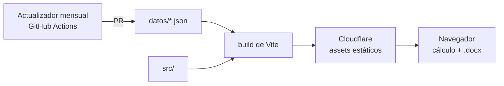

# Calculadora de honorarios

Calculadora web de honorarios por hora para trabajadores autónomos de la
comunicación —community managers, cronistas, creadores de contenido,
conductores, redactores, fotoperiodistas, productores y editores de video—
monotributistas de Chaco y Corrientes.

El honorario parte del salario del convenio colectivo de cada rol y le suma,
según lo que el usuario marque, los adicionales de convenio, los costos que el
autónomo paga de su bolsillo (monotributo, ingresos brutos, equipo,
conectividad, movilidad), los fondos de vacaciones y aguinaldo y un ajuste por
tipo de cliente. El resultado se descarga como presupuesto en Word, editable.

## Arquitectura

Sitio estático, sin backend ni base de datos. El cálculo y el documento Word se
generan en el navegador: nada de lo que carga el usuario sale de su equipo.



Los valores —roles, ítems, categorías de monotributo, ingresos brutos por
provincia, precio del combustible— viven en `datos/`, con su vigencia y la norma
que los respalda, y se validan contra un esquema. El código no contiene montos:
agregar un rol, un ítem o una categoría es agregar un dato.

## Datos

| Archivo | Qué guarda |
|---|---|
| `roles.json` | Los roles, con su valor base mensual y el convenio del que sale |
| `items.json` | Los ítems del honorario, sus grupos y los conjuntos excluyentes (plazo, tipo de cliente) |
| `monotributo.json` | Categorías del monotributo: impuesto integrado, SIPA, obra social y tope |
| `provincias.json` | Cómo tributa ingresos brutos un monotributista en cada provincia |
| `combustible.json` | Precio del litro de nafta por provincia |
| `parametros.json` | Horas mensuales, jornada, vida útil de equipos, consumo del auto, vacaciones, SAC y dólar |
| `esquema/` | Un JSON Schema por archivo, más `comun.schema.json` con las definiciones compartidas |

Cada valor lleva su `vigencia` (`AAAA-MM`) y la `norma` que lo respalda. Los
ítems tienen un `tipo` que define cómo entran al cálculo:

| Tipo | Cómo se calcula |
|---|---|
| `porcentual` | Porcentaje del valor hora por las horas del trabajo |
| `mensual` | Costo mensual prorrateado por hora; en pesos (`valor`) o en dólares (`dolares`) |
| `por-jornada` | Monto por cada jornada de 6 horas, redondeando hacia arriba |
| `por-trabajo` | Monto que carga el usuario, una vez por trabajo |
| `calculado` | Fórmula propia del motor (`monotributo`, `ingresos-brutos`, `fondo-vacaciones`, `fondo-sac`, `amortizacion`, `movilidad`) |

`porRol` reemplaza el valor para un rol puntual. `actualizacion.regla` indica
cómo se mantiene al día el valor: `manual`, `ipc-nea`, `dolar-oficial`,
`combustible` o `fija`.

Para cambiar o agregar un valor se edita el JSON y se corre
`npm run validar-datos`. La verificación de cada PR lo corre también, y los
tests comprueban las referencias entre archivos y que ningún monto quede
escrito en `src/`.

## Estructura

| Ruta | Qué vive adentro |
|---|---|
| `datos/` | Valores de cálculo y su esquema |
| `scripts/` | `validar-datos.mjs`; más adelante, el actualizador de valores indexados |
| `src/main.tsx` · `src/App.tsx` | Arranque |
| `src/util/datos/` | Carga tipada de `datos/` |
| `src/util/` | Funciones puras: motor de cálculo y armado del presupuesto |
| `src/paginas/` · `src/componentes/` · `src/layout/` | Interfaz |
| `src/hooks/` · `src/contexto/` | Estado de la interfaz |
| `src/estilos/` | `tokens.css` (variables de diseño), `base.css` y una hoja por sección |
| `src/test/` | Tests de Vitest, espejando `src/` |
| `.github/workflows/` | Verificación de cada PR |

## Cómo se corre

Requiere Node 24.

```sh
npm ci
npm run dev      # servidor de desarrollo
npm test         # tests
npm run validar-datos  # datos/ contra sus esquemas
npm run lint     # ESLint
npm run build    # tipos + build de producción en dist/
```

## Ramas

`develop` integra; `main` es lo publicado. Cada cambio entra a `develop` por PR
desde una rama `feature/…`, y la verificación (lint, tipos, tests y build) tiene
que pasar antes de mergear.
