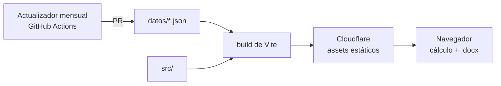

# Calculadora de honorarios

Calculadora web de honorarios por hora para trabajadores autónomos de la
comunicación —community managers, cronistas, creadores de contenido,
conductores, redactores, fotoperiodistas, productores y editores de video—
monotributistas de Chaco y Corrientes.

El honorario parte del salario del convenio colectivo de cada rol y le suma,
según lo que el usuario marque, los adicionales de convenio, los costos que el
autónomo paga de su bolsillo (monotributo, ingresos brutos, equipo,
conectividad, movilidad), los fondos de vacaciones y aguinaldo y un ajuste por
tipo de cliente. El resultado se descarga como presupuesto en Word, editable.

## Arquitectura

Sitio estático, sin backend ni base de datos. El cálculo y el documento Word se
generan en el navegador: nada de lo que carga el usuario sale de su equipo.



Los valores —roles, ítems, categorías de monotributo, ingresos brutos por
provincia, precio del combustible— viven en `datos/`, con su vigencia y la norma
que los respalda, y se validan contra un esquema. El código no contiene montos:
agregar un rol, un ítem o una categoría es agregar un dato.

## Estructura

| Ruta | Qué vive adentro |
|---|---|
| `datos/` | Valores de cálculo y su esquema |
| `scripts/` | Actualizador de valores indexados |
| `src/main.tsx` · `src/App.tsx` | Arranque |
| `src/util/` | Funciones puras: motor de cálculo y armado del presupuesto |
| `src/paginas/` · `src/componentes/` · `src/layout/` | Interfaz |
| `src/hooks/` · `src/contexto/` | Estado de la interfaz |
| `src/estilos/` | `tokens.css` (variables de diseño), `base.css` y una hoja por sección |
| `src/test/` | Tests de Vitest, espejando `src/` |
| `.github/workflows/` | Verificación de cada PR |

## Cómo se corre

Requiere Node 24.

```sh
npm ci
npm run dev      # servidor de desarrollo
npm test         # tests
npm run lint     # ESLint
npm run build    # tipos + build de producción en dist/
```

## Ramas

`develop` integra; `main` es lo publicado. Cada cambio entra a `develop` por PR
desde una rama `feature/…`, y la verificación (lint, tipos, tests y build) tiene
que pasar antes de mergear.
